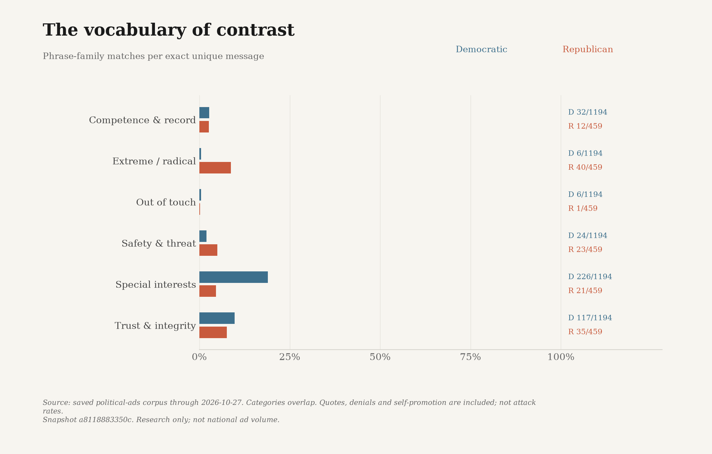
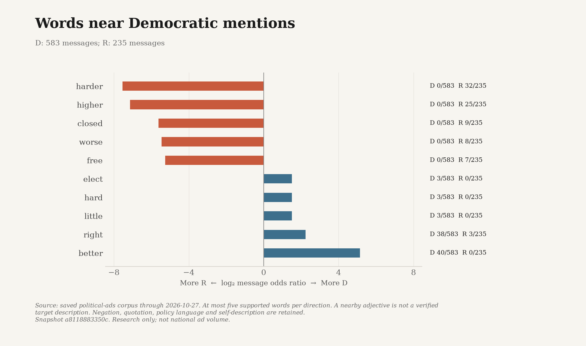
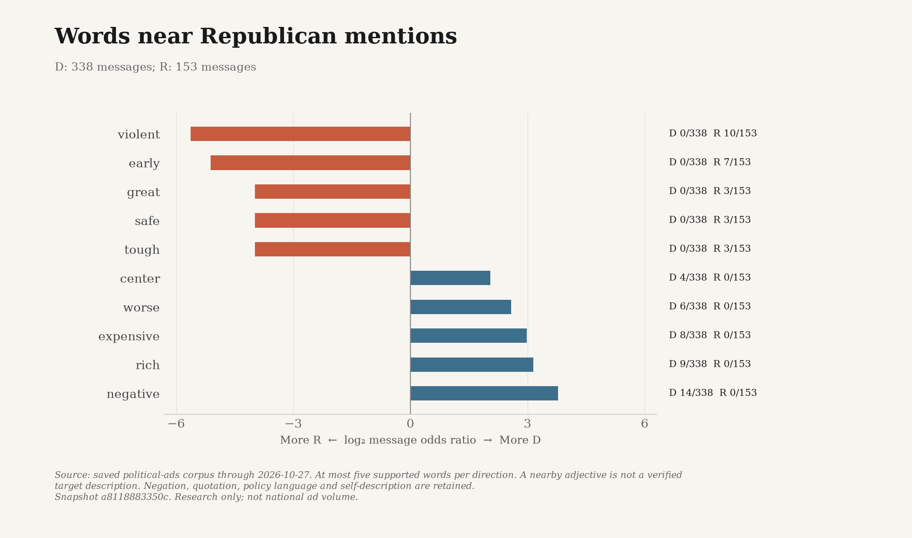
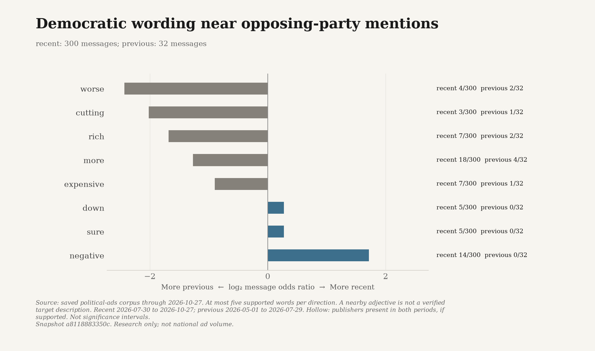
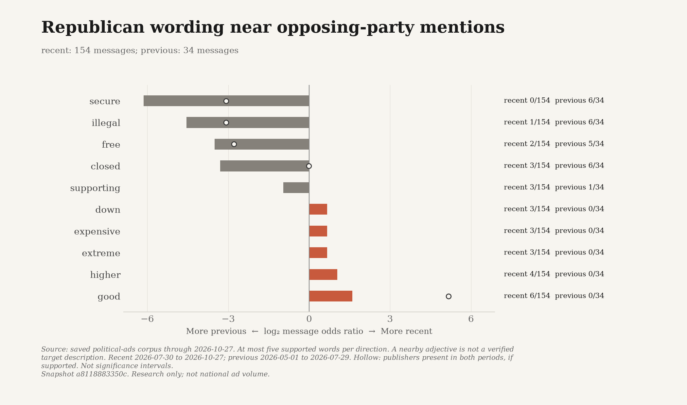

# How Democrats and Republicans talk in their 2026 ads

Issue language, opponent portrayals and the limits of an uneven collection.

**DRAFT - NOT PUBLISHED.** Prepared for Substack; images are local PNG files. No upload, scheduling or publication has occurred.

Data through 2026-10-27. Snapshot `a8118883350c2e466a5a2d5b64f10d643fbe0c4a12be9cf7541523b989da6145`.

Political ads tell voters what a campaign wants them to notice: a price, a policy, an achievement, or something allegedly wrong with the other candidate. Comparing the words can reveal recurring themes. It is harder to distinguish a real party difference from the particular publishers, races and ad formats we happened to recover.

This snapshot contains 1,751 English-language ad-text records through 2026-10-27: 1,216 Democratic-aligned, 496 Republican-aligned, 31 other and 8 unresolved. After exact-text deduplication within each party, the D/R comparisons use 1,194 and 459 messages. These are recovered releases, previews and original creatives, not a census of advertisements aired or a measure of exposure.

Republican House coverage includes 146 English text records. It remains uneven: more records from a few campaigns do not establish coverage of every Republican House candidate. Missing ads are unknown, not evidence of silence.

## The issue-language differences in this collection

The most frequent published issue family on the Democratic side is Cost of living: 458/1,194 exact messages (38.4%). A match means one of the codebook's phrases appears in the available text. It is not an independent judgment of the ad's main topic, accuracy or effectiveness.

The most frequent published issue family on the Republican side is Taxes & spending: 144/459 exact messages (31.4%). A match means one of the codebook's phrases appears in the available text. It is not an independent judgment of the ad's main topic, accuracy or effectiveness.

Each message contributes at most once to each family. Categories overlap. There is no spending, impression or airing weight, and an OCR preview is not equivalent to a complete broadcast transcript.

*Exact phrase-family presence; counts and denominators shown.* [Exact data](figures/issue-language.csv).

## What the ads actually say about opponents

A small set of source-checked passages makes the difference between wording and portrayal concrete. The examples below are illustrations, not representative estimates of how often either party attacks. The report retains the complete ad text and the review's speaker and target notes.

> [NARRATOR] Price Hike Mike is out of touch.

Democratic-aligned advertiser on Mike Rogers. The ad alternates news clips, a Rogers quotation, and advertiser narration. This excerpt is the narrator's conclusion, not Rogers's own description. [Original source](https://www.dscc.org/article/new-ad-campaign-slams-price-hike-mike-rogers-for-dismissing-skyrocketing-michigan-gas-prices/).

> Cuellar is with radical Democrats, not us

Republican-aligned advertiser on Henry Cuellar. The full script links Cuellar to other Democrats and criticizes his votes and record. This is the advertiser's closing portrayal, not an endorsement by Cuellar or a finding about his ideology. [Original source](https://www.nrcc.org/2026/01/13/%f0%9f%9a%a8new-nrcc-launches-ad-blasting-cuellar-for-failing-south-texas/).

The broader phrase-family chart counts vocabulary such as extreme/radical, trust/integrity and special interests. It includes quoted and denied language and positive descriptions. Calling it an attack-rate chart would go beyond what has been measured.

*Exact phrase-family presence; counts and denominators shown.* [Exact data](figures/portrayal-language.csv).

## A closer look at descriptive words

The next comparison follows the question in the Harris/Trump media-coverage analysis, but not its assumptions about a different corpus. Here we compare D- and R-aligned messages in contexts mentioning Democratic candidates or the party, then do the same for Republican mentions. Full candidate names and explicit party names are required. Surname-only references, some nicknames and misrecognized names can be missed.

A bundled general-English lexicon supplies words with adjective-polarity entries. We do not give advertisements sentiment scores or claim that each occurrence is grammatically an adjective. Words must be within 12 tokens of an explicit mention in the same sentence and evidence lane; mixed-party sentences are excluded. Each exact message counts once per word. The denominator includes eligible mention-context messages with no lexicon-word hit.

For Democratic mentions, the eligible denominators are 583 D-aligned and 235 R-aligned messages. These are smaller and more selective than the issue-chart denominators.

*Supported lexicon-word contrasts in unreviewed mention contexts.* [Exact data](figures/descriptors-D.csv).

For Republican mentions, the eligible denominators are 338 D-aligned and 153 R-aligned messages. These are smaller and more selective than the issue-chart denominators.

*Supported lexicon-word contrasts in unreviewed mention contexts.* [Exact data](figures/descriptors-R.csv).

The horizontal scale is a smoothed log2 message-presence odds ratio, not a sentiment score or a significance test. Only comparisons with at least ten messages per group and a word in at least three messages on one side are ranked. The charts show at most five supported contrasts in either direction; all supported words and their exact counts remain in the downloads.

Reading the original contexts changes what a tempting headline would imply. These additional source-bound examples were checked specifically to illustrate the limitations of proximity, not to validate all extracted contexts.

> Christina Hines has a better idea.

This is positive self-side promotion of the supported candidate, not a Democratic description of a Republican opponent. The recovered text includes machine-recognition uncertainty. [Original source](https://www.snap.com/political-ads/asset/57bb404c169afebbdb1fdc2822168457bbf19044605213d0795042c081e2351e?mediaType=mp4).

> Thanks to Republicans, violent crime is at all-time lows

Violent modifies crime, not Republican candidates. The ad presents falling violent crime as a Republican achievement; this does not independently verify its crime claim. [Original source](https://www.nrsc.org/press-releases/nrsc-launches-police-week-ad-condemning-graham-platners-pro-crime-agenda-2026-05-13/).

A word near a Republican name is not necessarily a word describing that person. It can describe crime, prices, an opponent's quotation or the advertiser's own candidate. Negation is retained rather than flipped into a new sentiment label. Ideological wording missing from the general-English lexicon is addressed separately by the published phrase families.

## What changes in the last ninety days?

The recent window is 2026-07-30 to 2026-10-27; the preceding window is 2026-05-01 to 2026-07-29. We compare first-observed exact messages in contexts mentioning the opposing party, not how long a creative kept airing. For early-cycle snapshots, windows are limited by the collection's January 1 start.

For Democratic-aligned ads, the recent and preceding windows contain 300 and 32 eligible messages. Keeping only publishers present in both windows leaves 62 and 8. That subset does not meet the group-size threshold, so its word contrasts are not ranked.

*Supported lexicon-word contrasts in unreviewed mention contexts.* [Exact data](figures/descriptor-change-D.csv).

For Republican-aligned ads, the recent and preceding windows contain 154 and 34 eligible messages. Keeping only publishers present in both windows leaves 18 and 34. That subset meets the group-size threshold, but it does not hold race, format, candidate or election phase constant.

*Supported lexicon-word contrasts in unreviewed mention contexts.* [Exact data](figures/descriptor-change-R.csv).

These plots are exploratory changes in the saved collection. A rise can reflect newly recovered sources or changed-target templates, not a nationwide change in party strategy. The monthly figures make the uneven historical coverage visible.

*Monthly D/R first-observed exact-message counts.* [Exact data](figures/monthly-coverage.csv).

*All issue families by first-observed month; missing denominators break lines.* [Exact data](figures/monthly-issues.csv).

## How much of the difference is the source mix?

We remove each party's largest publisher by source-record count and recalculate the exact-message shares. In this snapshot the exclusions are Democratic: AFL-CIO; Republican: Senate Leadership Fund. This is a stress test, not a balanced sample or an estimate corrected for all missing advertising.

The largest absolute full-sample issue gap is Cost of living. D-aligned messages match it in 458/1,194 (38.4%); R-aligned messages in 94/459 (20.5%). After the exclusions those values are 382/913 (41.8%) and 88/309 (28.5%). The changed comparison shows why the original gap should not be read as a source-independent party effect.

*Largest five publishers per party and all remaining publishers.* [Exact data](figures/publisher-composition.csv).

*Issue shares before and after removing the largest record publisher.* [Exact data](figures/source-sensitivity.csv).

## What this does - and does not - establish

This collection supports a checkable description of the words recovered from these ads, along with a small number of context-reviewed opponent portrayals. It does not establish national advertising prevalence, factual truth, persuasion, audience reach or the parties' private intentions. Speaker quotation, extraction quality, primary attacks and positive self-description still require context.

The final eligibility cutoff remains 2026-11-04, inclusive. The current snapshot stops at 2026-10-27; uncollected future dates are not zeros. Research refreshes may update the saved evidence, figures and both drafts, but website and Substack publication remain on hold.

## Evidence and methods

[Complete text and evidence (CSV)](analysis-ads.csv) | [Complete local analysis (JSON)](analysis.json) | [Technical report](analysis.html) | [All chart data](figures/chart-data.json) | [Descriptor contexts](figures/descriptor-evidence.json)

For a future Substack edition, upload the PNGs and replace the local evidence links only after an authorized destination exists. These draft links do not claim that any public page or download is live.
