# How Democrats and Republicans describe each other

Opponents, their own candidates, and the balance of negative and positive portrayals.

**DRAFT - NOT PUBLISHED.** Prepared for Substack; images are local PNG files. No upload, scheduling or publication has occurred.

Data through 2026-10-30. Snapshot `0de6d4be3282d255f5a25243257d89c5944f83ab7d9eae0396e0f89d48aaf302`.

The recovered ads differ in the reputations they build and attack. Among reviewed messages describing opposing-party people, Democratic ads put more emphasis on honesty, corruption and trustworthiness (150/520 (28.8%), compared with 55/275 (20.0%) on the other side); Republican ads put more emphasis on ideology and extremism (55/275 (20.0%), compared with 22/520 (4.2%) on the other side). These are the largest observed frame gaps in each direction, not national estimates or evidence of a pure party effect.

This comparison asks who an ad describes, what it says about that person, and whether it attacks an opponent or praises its own candidate. It reads descriptions in context, rather than treating an angry word or a word near a name as a portrayal.

The saved collection through 2026-10-30 contains 1,819 English ad-text records: 1,226 Democratic-aligned, 554 Republican-aligned, 31 other and 8 unresolved. After exact-message deduplication, the D/R comparison contains 1,204 and 517 messages. These are recovered ad releases, previews and creatives, not all ads aired, and there is no exposure or spending weight.

## First, what has been reviewed?

Democratic-aligned messages: 1,197/1,204 (99.4%) reviewed; 2 uncertain, 4 unreviewed and 1 stale. Only reviewed messages supply counted descriptions. The whole-ad table retains all messages in its denominator; person-scope tone rates require an eligible description. Missing evidence is not neutral language.

Republican-aligned messages: 458/517 (88.6%) reviewed; 1 uncertain, 58 unreviewed and 0 stale. Only reviewed messages supply counted descriptions. The whole-ad table retains all messages in its denominator; person-scope tone rates require an eligible description. Missing evidence is not neutral language.

These are AI-assisted full-text contextual labels, not independently validated human judgments. Exact passages, target anchors and input hashes are retained. A reported allegation is a portrayal, not this project's finding that it is true.

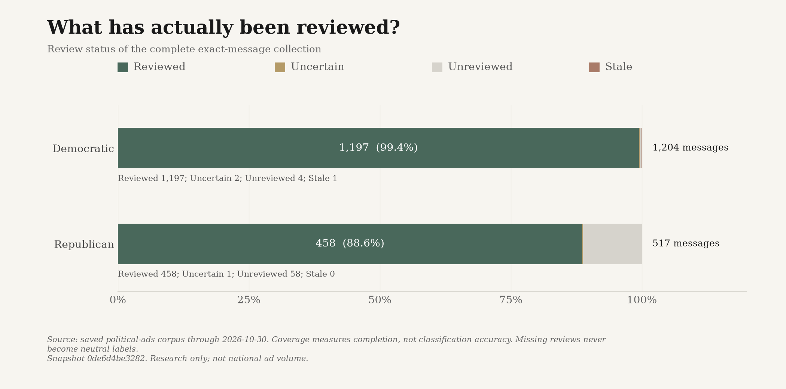

*Reviewed, uncertain, unreviewed and stale exact messages by advertiser alignment.* [Exact data](figures/portrayal-coverage.csv).

## Does the same ad praise its own side, attack the other side, or do both?

Shares of all exact party/messages, not just messages describing people. Own-side praise is an endorsed positive description of a supported person or collective with the advertiser's party; opponent criticism is an endorsed negative description of an opposing-party person or collective. Mixed/contrast requires both in the same message. 'Only' means one of these two signals without the other; other sentiments can coexist. Neither is not neutral. Same-party rivals, unknown target parties, quoted opponents and rebutted or unclear voices do not supply these signals. Uncertain, unreviewed and stale messages stay in the denominator but are reported separately, never classified as neither. Displayed percentages are rounded.

How this is calculated: first select one record per advertiser-alignment/message, normalizing only whitespace and case and keeping the earliest in-scope release or reported/scheduled delivery date, then ad ID to break ties. Read its saved contextual review for own-party praise and opposing-party criticism. Divide each category's message count by all unique messages for that alignment, including missing reviews. The open-source audit-strategy command independently checks these counts and exports each message's full text, review and the passages supplying either signal. This reproduces arithmetic from saved AI-assisted decisions, not the original model judgments; exact original prompts and decoding settings are not in the ledger.

Democratic ads: own-side praise only: 478/1,204 (39.7%); mixed: own praise and opponent criticism: 105/1,204 (8.7%); opponent criticism only: 413/1,204 (34.3%); neither signal: 201/1,204 (16.7%); uncertain or missing review: 7/1,204 (0.6%). These mutually exclusive categories account for every unique message. This same-ad contrast measure is different from mixed positive/negative descriptions within one target scope below.

Republican ads: own-side praise only: 126/517 (24.4%); mixed: own praise and opponent criticism: 76/517 (14.7%); opponent criticism only: 220/517 (42.6%); neither signal: 36/517 (7.0%); uncertain or missing review: 59/517 (11.4%). These mutually exclusive categories account for every unique message. This same-ad contrast measure is different from mixed positive/negative descriptions within one target scope below.

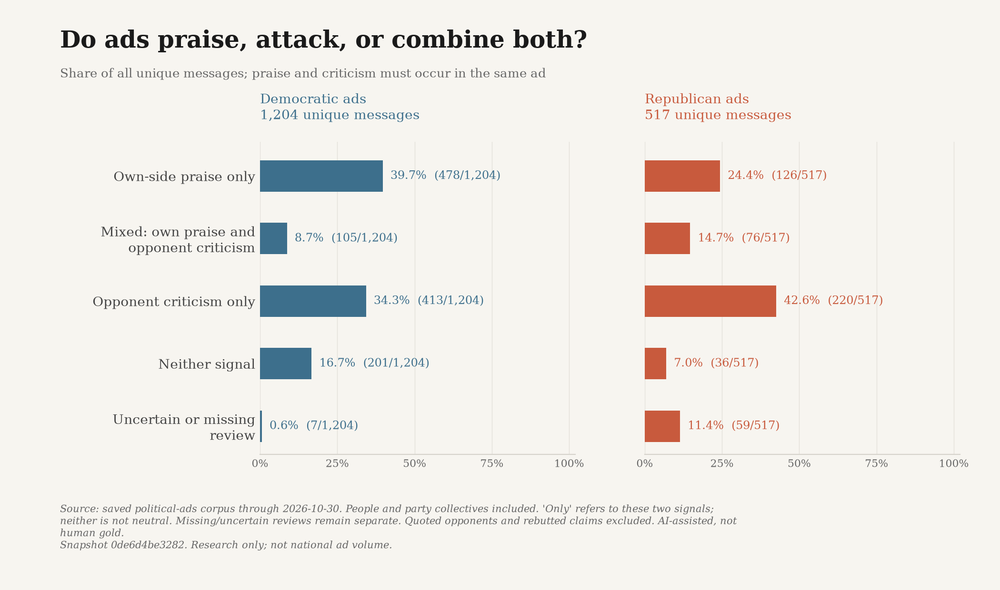

*Own-side praise, opponent criticism or both within the same ad; shares of all unique messages.* [Exact data](figures/ad-strategy.csv).

## How they describe the other side

This comparison counts endorsed descriptions of named people. Opposing-party collectives and same-party primary rivals are reported separately in the technical report. Quoted opponents and allegations being rebutted do not become the advertiser's own views.

Democratic ads have an eligible description in 520/1,197 (43.4%) reviewed messages; 677 have no description in this scope. Among messages with a description, negative only: 508/520 (97.7%); positive only: 1/520 (0.2%); both positive and negative: 8/520 (1.5%); neutral only: 3/520 (0.6%).

Including mixed messages, the share with any negative portrayal is 516/520 (99.2%); the share with any positive portrayal is 9/520 (1.7%). Those two percentages overlap; they are not competing pieces of one total.

Republican ads have an eligible description in 275/458 (60.0%) reviewed messages; 183 have no description in this scope. Among messages with a description, negative only: 274/275 (99.6%); positive only: 0/275 (0.0%); both positive and negative: 0/275 (0.0%); neutral only: 1/275 (0.4%).

Including mixed messages, the share with any negative portrayal is 274/275 (99.6%); the share with any positive portrayal is 0/275 (0.0%). Those two percentages overlap; they are not competing pieces of one total.

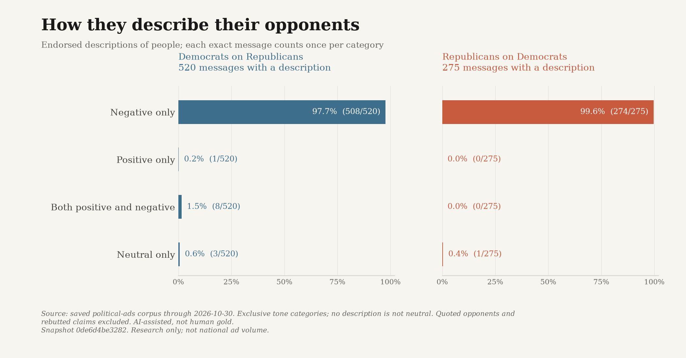

*Context-coded message shares among reviewed ads with an eligible person description.* [Exact data](figures/opponent-tone.csv).

The most common Democratic description frames in this scope are who they serve or put first (214/520 (41.2%)); record, actions and policy pledges (180/520 (34.6%)); honesty, corruption and trustworthiness (150/520 (28.8%)). A message can use several frames, so these percentages overlap.

> Republicans like Jay Feeley talk about trans people a lot.

Democratic-aligned Common Ground Coalition PAC on Jay Feely: negative; who they serve or put first. Voice: advertiser. Ad snap-3a170b5b4f637d7a469a508b. [Original source](https://www.snap.com/political-ads/asset/897f15d7aa8c086055e061e7867d55984a08370d62fb658e72f6ef111a073396?mediaType=mp4).

> David Valideo voted to cut Medicaid

Democratic-aligned AFSCME PEOPLE on David Valadao: negative; record, actions and policy pledges. Voice: adopted clip. Ad snap-33dd56d3aaeb6b72cddfd524. [Original source](https://www.snap.com/political-ads/asset/dfe24ff96675d65c68b9cc36b1dcfe11c10b9e3bcfaf3f326311e2fc1bf07229?mediaType=mp4).

> She sold us out.

Democratic-aligned WinSenate on Ashley Hinson: negative; honesty, corruption and trustworthiness. Voice: adopted clip. Ad snap-53f8cccf7f18deff3df68f84. [Original source](https://www.snap.com/political-ads/asset/4d610dcd3150994940b4d6296c2e06650f344ca420059f3303db9518355b7462?mediaType=mp4).

The most common Republican description frames in this scope are who they serve or put first (129/275 (46.9%)); record, actions and policy pledges (86/275 (31.3%)); ideology and extremism (55/275 (20.0%)). A message can use several frames, so these percentages overlap.

> Dave Min voted for higher taxes… and voted to make your life harder.

Republican-aligned NRCC on Dave Min: negative; who they serve or put first. Voice: advertiser. Ad nrcc-22fd91ea37be2558-0. [Original source](https://www.nrcc.org/2026/04/15/nrcc-launches-paid-ad-campaign-targeting-dave-min-for-raising-taxes-on-working-families/).

> Liberal Josh Turing missed 58% of his votes.

Republican-aligned Senate Leadership Fund on Josh Turek: negative; record, actions and policy pledges. Voice: advertiser. Ad snap-f1b953ca2205ef0ef6553f6d. [Original source](https://www.snap.com/political-ads/asset/8f1987dbc61218dc4671d290d92c5888da28e9f0211e8e6f251a415b0095995f?mediaType=mp4).

> “Seniors can’t afford Josh Turek’s tax-and-spend agenda.”

Republican-aligned NRSC on Josh Turek: negative; ideology and extremism. Voice: advertiser. Ad nrsc-17011-0. [Original source](https://www.nrsc.org/press-releases/josh-turek-wants-to-tax-seniors-social-security-2026-08-18/).

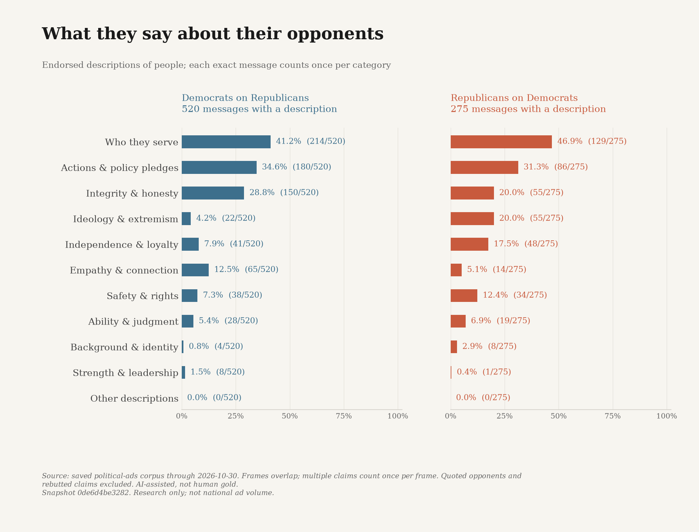

*Context-coded message shares among reviewed ads with an eligible person description.* [Exact data](figures/opponent-frames.csv).

## How they describe their own candidates

The same definitions apply to the advertiser's own or supported candidates. Supporting a candidate is not itself a positive personality description: the ad must actually attribute a quality, background, conduct or record. Policy pledges count as attributed commitments, not accomplished results.

Democratic ads have an eligible description in 612/1,197 (51.1%) reviewed messages; 585 have no description in this scope. Among messages with a description, negative only: 0/612 (0.0%); positive only: 605/612 (98.9%); both positive and negative: 2/612 (0.3%); neutral only: 5/612 (0.8%).

Including mixed messages, the share with any negative portrayal is 2/612 (0.3%); the share with any positive portrayal is 607/612 (99.2%). Those two percentages overlap; they are not competing pieces of one total.

Republican ads have an eligible description in 174/458 (38.0%) reviewed messages; 284 have no description in this scope. Among messages with a description, negative only: 0/174 (0.0%); positive only: 169/174 (97.1%); both positive and negative: 0/174 (0.0%); neutral only: 5/174 (2.9%).

Including mixed messages, the share with any negative portrayal is 0/174 (0.0%); the share with any positive portrayal is 169/174 (97.1%). Those two percentages overlap; they are not competing pieces of one total.

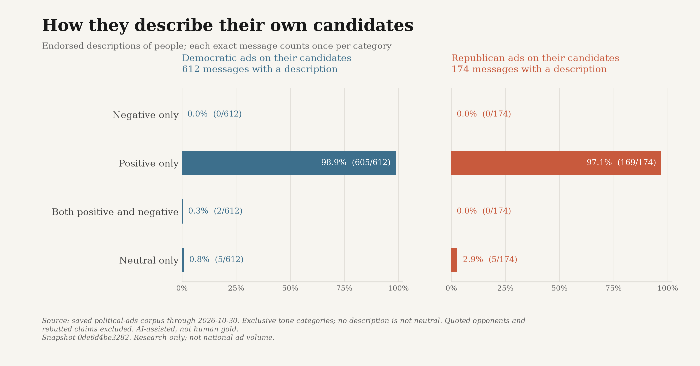

*Context-coded message shares among reviewed ads with an eligible person description.* [Exact data](figures/self-tone.csv).

The most common Democratic description frames in this scope are who they serve or put first (294/612 (48.0%)); record, actions and policy pledges (131/612 (21.4%)); strength, courage and leadership (112/612 (18.3%)). A message can use several frames, so these percentages overlap.

> TO FIGHT BACK
> AGAINST BILLIONAIRES!

Democratic-aligned AFL-CIO on Lindsay James: positive; who they serve or put first. Voice: advertiser. Ad snap-046abbf4ef94bcb1967b3e6e. [Original source](https://www.snap.com/political-ads/asset/2bd0439e27f51b1f5cffec28ce43be8e0c5ab844a1bb582af67f5539d4b84bc4?mediaType=png).

> BOB BROOKS
> LOWER COSTS
> AND RAISE WAGES.

Democratic-aligned AFL-CIO on Bob Brooks: positive; record, actions and policy pledges. Voice: advertiser. Ad snap-66da9566fb8049ca282189a5. [Original source](https://www.snap.com/political-ads/asset/a90253a256a5ce82af52e028a7b6fb786888d7c2d883e04631a21d77de8e5e33?mediaType=mp4).

> VOTE FOR
> TO FIGHT BACK
> AGAINST BILLIONAIRES!

Democratic-aligned AFL-CIO on Troy Jackson: positive; strength, courage and leadership. Voice: advertiser. Ad snap-83f43dbae523e61b278d0a2b. [Original source](https://www.snap.com/political-ads/asset/e8ef623502f784eae3623762fdcea9e728c45c67b8bd6a9cdc3b4f1d7410e367?mediaType=mp4).

The most common Republican description frames in this scope are record, actions and policy pledges (99/174 (56.9%)); strength, courage and leadership (40/174 (23.0%)); independence or loyalty to a party/leader (25/174 (14.4%)). A message can use several frames, so these percentages overlap.

> Gabe Evans delivered help for working families.

Republican-aligned NRCC on Gabe Evans: positive; record, actions and policy pledges. Voice: advertiser. Ad nrcc-a37dc0e224f4f4a0-0. [Original source](https://www.nrcc.org/2026/04/14/nrcc-launches-tax-day-ad-blitz-highlighting-gabe-evans-tax-relief/).

> He’s a good guy and a warrior.

Republican-aligned Andy Barr for Senate on Andy Barr: positive; strength, courage and leadership. Voice: adopted clip. Ad barr-1560-0. [Original source](https://barrforsenate.com/press-release/new-barr-ad-features-president-trump-praising-him-as-a-good-guy-and-a-warrior/).

> “I’m running for Congress to help President Trump.

Republican-aligned Brian Stover for Congress on Brian Stover: positive; independence or loyalty to a party/leader. Voice: advertiser. Ad stover-43-0. [Original source](https://www.brianstoverforcongress.com/2026/01/01/brian-stover-releases-new-television-ad-take-out-the-trash/).

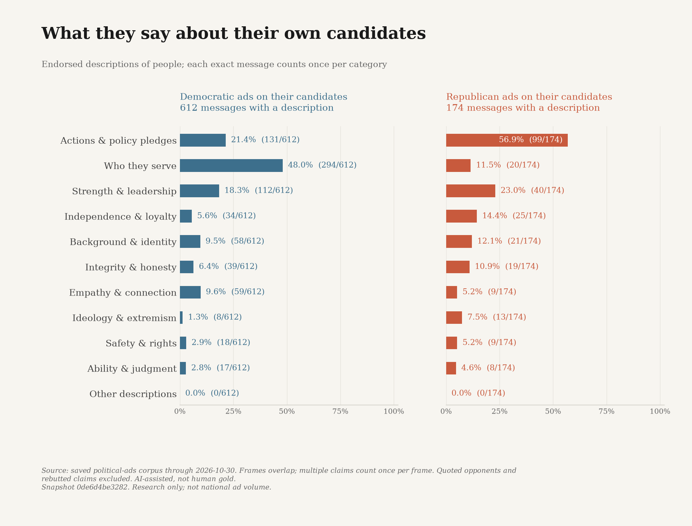

*Context-coded message shares among reviewed ads with an eligible person description.* [Exact data](figures/self-frames.csv).

## Are these party differences or differences in the sources?

A source-mix check removes each party's largest publisher by record count and deduplicates again: Democratic: AFL-CIO; Republican: Senate Leadership Fund. This cannot turn an opportunistic collection into a representative sample.

For Democratic ads, the whole-ad shares change after exclusion: own-side praise only from 478/1,204 (39.7%) to 286/923 (31.0%); mixed: own praise and opponent criticism from 105/1,204 (8.7%) to 104/923 (11.3%); opponent criticism only from 413/1,204 (34.3%) to 411/923 (44.5%). Each denominator includes all unique messages remaining in that collection.

For Democratic ads describing opposing-party people, any-negative portrayals change from 516/520 (99.2%) to 513/517 (99.2%) after that exclusion. Differences can still reflect races, phases, extraction formats and repeated changed-target templates, not a pure party effect.

For Republican ads, the whole-ad shares change after exclusion: own-side praise only from 126/517 (24.4%) to 117/359 (32.6%); mixed: own praise and opponent criticism from 76/517 (14.7%) to 76/359 (21.2%); opponent criticism only from 220/517 (42.6%) to 97/359 (27.0%). Each denominator includes all unique messages remaining in that collection.

For Republican ads describing opposing-party people, any-negative portrayals change from 274/275 (99.6%) to 154/155 (99.4%) after that exclusion. Differences can still reflect races, phases, extraction formats and repeated changed-target templates, not a pure party effect.

The party ordering reverses after this source exclusion for own-side praise only and opponent criticism only. Those raw gaps are source-sensitive, not general party differences.

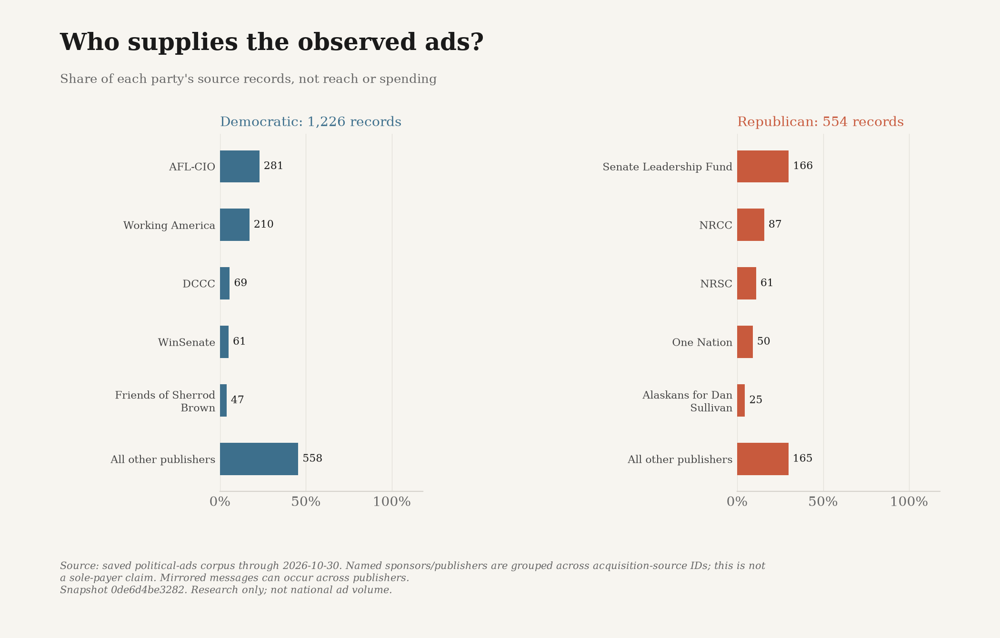

*Largest five publishers per party and all remaining publishers.* [Exact data](figures/publisher-composition.csv).

## The issues and collection history are supporting context

The following charts remain lexical and descriptive of collection coverage. An issue phrase in a quotation is still a match; these are not person-tone labels or measures of how much either party advertised.

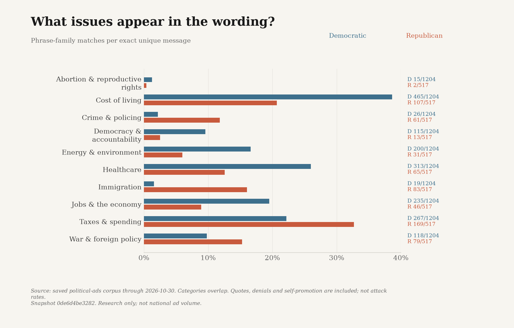

*Exact phrase-family presence; counts and denominators shown.* [Exact data](figures/issue-language.csv).

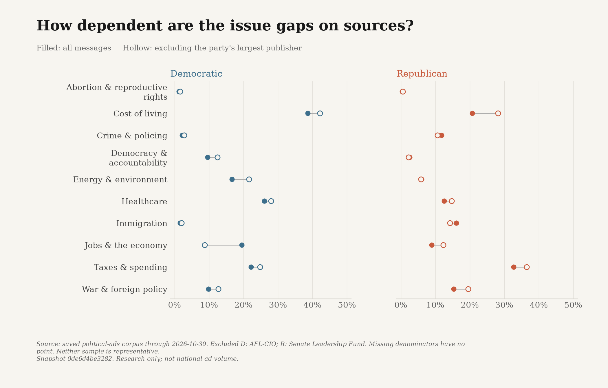

*Issue shares before and after removing the largest record publisher.* [Exact data](figures/source-sensitivity.csv).

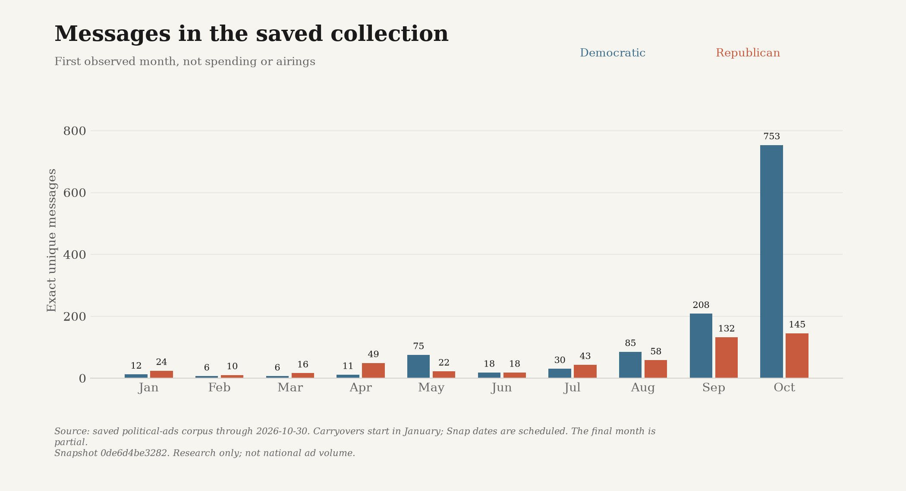

*Monthly D/R first-observed exact-message counts.* [Exact data](figures/monthly-coverage.csv).

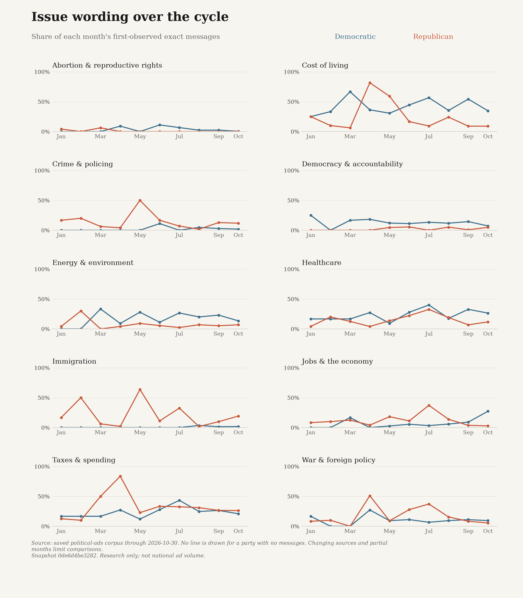

*All issue families by first-observed month; missing denominators break lines.* [Exact data](figures/monthly-issues.csv).

## What the evidence can establish

This identifies attributed descriptions in the recovered text. It cannot establish national prevalence, factual truth, persuasion or voter exposure. ASR/OCR can misrecognize names and negation. Sparse Republican House and early-cycle coverage remain limitations; missing ads are not evidence of silence.

Illustrations are selected from the three most frequent frames per party/scope, using the most repeated exact descriptor phrase and then the shortest supporting passage, with ad ID as a tie-breaker and no repeated message within a scope. They illustrate the coded frames, not a representative sample or an intensity ranking.

The final eligibility cutoff remains 2026-11-04, inclusive. This snapshot stops at 2026-10-30. Automatic research refresh can add unreviewed evidence but does not silently classify it. Both editions remain unpublished; website and Substack publication and host integration remain on hold.

## Evidence and methods

[Complete text and evidence (CSV)](analysis-ads.csv) | [Complete local analysis (JSON)](analysis.json) | [Technical report](analysis.html) | [All chart data](figures/chart-data.json) | [Context-coded portrayals](figures/portrayal-evidence.json)

For a future Substack edition, upload the PNGs and replace the local evidence links only after an authorized destination exists. These draft links do not claim that any public page or download is live.
